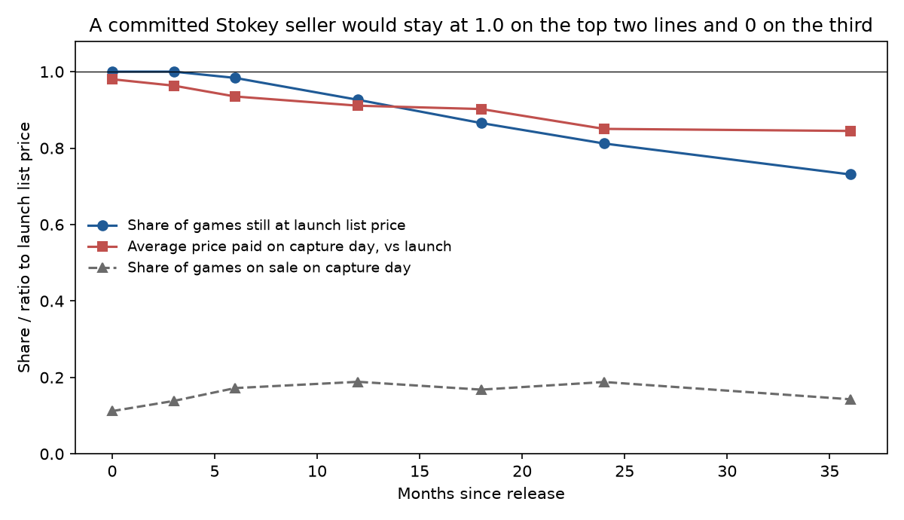
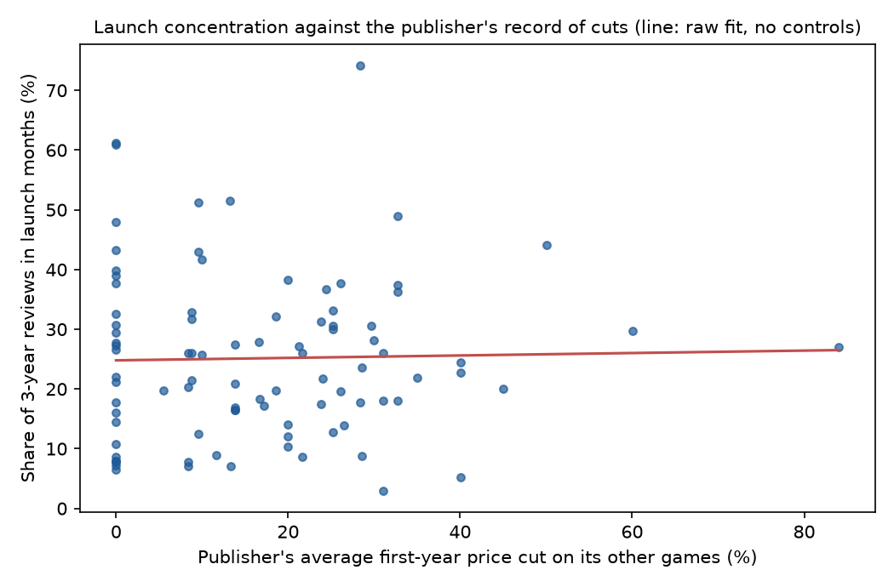

# The Patient Gamer

### In 1979, Nancy Stokey proved that a seller who can hold to a price gains nothing by cutting it. I checked her prediction against the price histories of 143 games on Steam.

---

Elden Ring went on sale on Steam on February 24, 2022, for $59.99. On the archived copies of its store page
from three years later, the price was still $59.99, and in November 2026 the Steam store still listed it at
$59.99. A digital copy costs FromSoftware and Bandai Namco, its publishers, nothing to make, so nothing about
costs has pushed the price down. CD Projekt Red kept the list price of Cyberpunk 2077 at $59.99 for years
too, but on one of the days the archives happened to capture its page the game was selling for $29.99, and on
one day Hogwarts Legacy, a $59.99 game from Warner Bros. Games, was selling for $8.99. Players who make a habit of waiting for days like those call themselves "patient gamers."

The puzzle is why a seller with the only copy of something would ever teach its customers to wait. Every buyer
who holds out for the Steam Summer Sale pays less than she would have paid at launch. Ronald Coase argued in 1972
that a monopolist selling something durable ends up competing with its own future prices. A young economist at
Northwestern named Nancy Stokey then worked out, in two papers, exactly when that competition bites and when it
does not. Video games are durable, each title is sold by the one publisher that owns it, and copies are free to
make, which makes them a clean test of her answer.

---

## Two measures

The first measure is how far a game's price has moved from its launch price. I track two prices on each
archived store page, the list price (the regular price shown when no sale is running) and the price actually
charged that day, which is lower when the game is on sale. For game $`i`$, $`h`$ months after release,

```math
R_{ih} = \frac{P_{ih}}{P_{i0}}
```

where $`P_{i0}`$ is the launch list price and $`P_{ih}`$ is the list price (or the paid price) at month
$`h`$. A seller who never cuts has $`R_{ih} = 1`$ forever. Capcom launched Monster Hunter: World at $59.99 in
August 2018, and three years later its list price was $29.99.

```math
R_{\text{MHW},36} = \frac{29.99}{59.99} = 0.50
```

The second measure is how much of a game's buying happens at launch. Steam does not publish unit sales, but it
does publish, for every game, how many reviews were written in each month, and only owners can review. With
$`q_{im}`$ the number of reviews of game $`i`$ written in month $`m`$ after release (month 0 is the release
month), the launch share is

```math
L_i = \frac{q_{i0} + q_{i1}}{\sum_{m=0}^{35} q_{im}}
```

Elden Ring drew 776,083 reviews in its first three years, and 305,808 of them were written in February and March
2022.

```math
L_{\text{Elden Ring}} = \frac{305{,}808}{776{,}083} = 0.394
```

The two measures pin down what each theory predicts.

| Seller | Price ratio over time | Launch share |
|---|---|---|
| Committed seller, fixed group of buyers (Stokey 1979) | Stays at 1.0 | 1.0, everyone buys at once |
| Seller who cannot commit, frequent price changes (Stokey 1981) | Falls quickly toward cost, here near 0 | Low, buyers wait |
| Committed seller, new buyers arriving (Conlisk, Gerstner and Sobel 1984) | List price steady, periodic sales | Below 1.0, sales draw waiting buyers |

---

## Nancy Stokey's two answers

Nancy Stokey finished her PhD at Harvard in 1978 under Kenneth Arrow and joined the faculty at Northwestern,
where she wrote both papers. She moved to the University of Chicago in 1990 and spent most of her career on
dynamic economics, much of it with Robert Lucas, her colleague and husband, who died in 2023. *Recursive Methods
in Economic Dynamics*, the 1989 book she wrote with Lucas and Edward Prescott, is a graduate text on solving
problems where today's choice changes tomorrow's options. The two pricing papers apply that same skill to a
single firm.

The first, "Intertemporal Price Discrimination," appeared in the *Quarterly Journal of Economics* in August 1979.
It asks what a monopolist should do if it can announce a whole price path in advance and be held to it. Buyers
differ in how much they value the good, each buys at most one unit, and everyone discounts the future at the same
rate. A buyer of value $`v`$ who buys at date $`t`$ at price $`p(t)`$ gets $`e^{-rt}(v - p(t))`$. Write
$`x(v) = e^{-r t(v)}`$ for the discount weight at the date type $`v`$ chooses to buy, $`F`$ for the distribution
of values with density $`f`$, and $`U(v)`$ for a buyer's best surplus. The lowest type gets nothing, and the
envelope theorem gives $`U'(v) = x(v)`$. The seller's revenue then rewrites in terms of $`x`$ alone.

```math
\begin{aligned}
U(v) &= \int_0^{v} x(s)\,ds \\
\text{Revenue} &= \int \big[\,x(v)\,v - U(v)\,\big]\, f(v)\,dv \\
&= \int x(v)\Big[\,v - \frac{1 - F(v)}{f(v)}\Big] f(v)\,dv \\
x^*(v) &= \begin{cases} 1 & \text{if } v - \frac{1-F(v)}{f(v)} \ge 0 \\ 0 & \text{otherwise} \end{cases}
\end{aligned}
```

Revenue is a weighted sum of each buyer's marginal revenue, and the weight can be at most 1, which means selling
immediately. The best the seller can do is sell at once to every buyer with positive marginal revenue, at the
ordinary monopoly price, and never sell to anyone else. A falling price path only delays revenue from buyers the
seller would rather serve now. This is Stokey's result, restated by Rahul Deb in 2014 as a constant monopoly
price with all sales at the first instant. Anderson and Dana, restating the paper in a 2006 working paper, add
that a committed seller does want a falling price path when its real cost of production falls over time.

The second paper, "Rational Expectations and Durable Goods Pricing," appeared in the *Bell Journal of Economics*
in 1981 and removed the commitment. Now the seller picks each period's price when the period arrives, and buyers
anticipate that a seller left with unsold customers will cut. Stokey showed that the equilibrium depends on how
often the seller can move, and that as the period shrinks the outcome approaches the competitive one, with the
monopolist's profit going to zero. That is Coase's conjecture made precise. For values spread evenly between
zero and one dollar, zero cost and a per-period discount factor $`\delta`$, the stationary linear equilibrium
has a closed form, which my script checks against the equilibrium conditions (Gul, Sonnenschein and Wilson later
proved the limit result for a broad class of demand curves). The first price is

```math
p_0 = \frac{\sqrt{1-\delta}}{1+\sqrt{1-\delta}}
```

against $0.50 for the committed seller. With a 10% annual discount rate, the results look like this.

| How often the seller can change its price | First price, as a share of the committed price | Profit, as a share of committed profit |
|---|---|---|
| Once a year | 47% | 47% |
| Once a quarter | 27% | 27% |
| Once a month | 17% | 17% |
| Once a week | 8% | 8% |

A digital storefront lets a publisher reprice in days rather than years, which on paper puts every game near
the bottom row unless the publisher has some other way to commit.

The strongest objection to taking the 1979 result to data came from John Conlisk, Eitan Gerstner and Joel Sobel
in 1984, and in general form from Omar Besbes and Ilan Lobel in 2015. Stokey's buyers are all present at the
start. In real markets new buyers arrive every month, some patient and some not, and Besbes and Lobel proved that
a committed seller facing that stream should run a price cycle, with regular sales that sweep up the patient
buyers who have accumulated. Stokey's model was never meant to describe arrivals. The objection does mean that
her sharpest prediction concerns the list price, and that sales are where the two accounts part.

---

## How I tested it

I started from SteamSpy's ranked catalog of the 5,000 most-owned games on Steam, kept the paid ones, and asked
Steam's store API for the release date, publisher and current price of the 899 most-reviewed. Of the 472
released between January 2017 and October 2023, which gives each at least three years of history, I took the
300 most-reviewed and kept only fresh launches. A game that collected more than 2% of its first three years'
reviews before its official release month was already on sale in early access, so its Steam release date was not
a launch, and 83 games failed that test, among them Baldur's Gate 3 and Hades. I dropped 21 more from a
judgment list, mostly games sold for six months or more on another PC store before reaching Steam, such as
Battlefield 1 on EA's Origin and Borderlands 3 on the Epic Games Store, plus a few whose store page changed
product. That left the 196 most-reviewed fresh launches.

Steam does not publish price histories, so I rebuilt them from archived copies of each game's US store page.
Common Crawl, a nonprofit that crawls the web every month or two and publishes the pages, supplied captures for
the whole sample, and the Internet Archive's Wayback Machine supplied a second set for the 29 most-reviewed
games. For each game I took the capture nearest its release, from 75 days before to 31 days after (pre-orders are
sold at the launch price), and the capture nearest 3, 6, 12, 18, 24 and 36 months later, and read the list and
paid price of the standard edition. On the 140 game-dates both archives captured, the list prices agreed every
time. In all, 143 games had a launch capture, and they are the sample.

The test of Stokey's prediction is a regression of each game's log price change on a dummy for each month
since release, with no constant.

```math
\ln\!\Big(\frac{P_{ih}}{P_{i0}}\Big) = \sum_{k \in \{3,6,12,18,24,36\}} \beta_k \,\mathbf{1}[h = k] + \varepsilon_{ih},
\qquad H_0:\ \beta_k = 0 \ \text{for all } k
```

Each $`\beta_k`$ is the average log change from launch at month $`k`$. I run it for the list price, the paid
price, and a dummy for being on sale, with standard errors clustered by game.

For the extension I asked the question Stokey's 1981 paper raises. If buyers expect a seller to cut, they wait,
and a publisher with a habit of cutting should see less of its buying at launch. I measured each publisher's habit
as the average first-year price cut on its other games in the sample, leaving the game itself out, and regressed
the launch share on it.

```math
L_i = \alpha + \gamma\, \bar{c}_{-i,\,\text{pub}} + \delta \ln P_{i0} + \tau_{\text{year}(i)} + u_i,
\qquad H_0:\ \gamma = 0
```

Here $`\bar{c}_{-i,\,\text{pub}}`$ is the publisher's average cut on its other games, $`\ln P_{i0}`$ controls for
the launch price, $`\tau`$ is a release-year effect, and standard errors are clustered by publisher. The Coase
logic predicts $`\gamma < 0`$. This needs a publisher with at least two games, which leaves 91 games from 24
publishers.

---

## Most list prices hold for a year, and many hold for good

| Months after release | Games | Still at launch list price | Cut | Raised | On sale that day | Average paid price vs launch |
|---|---|---|---|---|---|---|
| 3 | 130 | 100% | 0% | 0% | 14% | 96% |
| 12 | 122 | 93% | 6% | 2% | 19% | 91% |
| 24 | 117 | 81% | 18% | 1% | 19% | 85% |
| 36 | 119 | 73% | 24% | 3% | 14% | 84% |
| November 2026 | 138 | 66% | 26% | 8% | 17% | 84% |

Not one game in the sample cut its list price in the first three months, and 93% were still at the launch list
price a year out. In formal terms, using the 95% interval from a binomial count,

```math
\Pr\big[R_{i,12} = 1\big] = 0.926,\quad 95\%\ \text{CI}\ [0.866,\ 0.961],\quad N = 122
```

and by month 36 the share was 0.731 (CI 0.645 to 0.803, N = 119). The typical game on Steam behaves much more
like Stokey's committed seller than like her seller without commitment, who in the weekly row of the table above
would open at 8% of the committed price.

The split by price is wide. Among the 17 games launched under $15, none had cut its list price by month
36, and two had raised it. Among the 58 launched at $40 or more, 40% had cut it, typically to two-thirds of the
launch price.

| Launch price | Games | List price unchanged at 36 months | Cut | Typical cut, if cut |
|---|---|---|---|---|
| Under $15 | 17 | 88% | 0% | none |
| $15 to $39.99 | 44 | 84% | 11% | to 67% of launch |
| $40 and up | 58 | 60% | 40% | to 67% of launch |

| Game | Publisher | Launch list | List at 36 months | List, Nov 2026 | Lowest paid on an archived day |
|---|---|---|---|---|---|
| Elden Ring | FromSoftware / Bandai Namco | $59.99 | $59.99 | $59.99 | $59.99 |
| Red Dead Redemption 2 | Rockstar Games | $59.99 | $59.99 | $59.99 | $40.19 |
| God of War | PlayStation Publishing | $49.99 | $49.99 | $49.99 | $39.99 |
| Hollow Knight | Team Cherry | $14.99 | $14.99 | $14.99 | $14.99 |
| Starfield | Bethesda Softworks | $69.99 | $49.99 | $49.99 | $48.99 |
| DOOM Eternal | Bethesda Softworks | $59.99 | $39.99 | $29.99 | $39.99 |
| Monster Hunter: World | Capcom | $59.99 | $29.99 | $29.99 | $19.79 |
| Phasmophobia | Kinetic Games | $13.99 | $13.99 | $19.99 | $13.99 |

The archives catch a page on a handful of days, so the last column is the lowest price on those days, not the
lowest price ever charged. Phasmophobia, which opened on Steam in early access and so passes the fresh-launch rule,
is one of the games whose price went up, the opposite of skimming.

---

## The discounting happens in sales, not in list prices

On an average capture day in the first three years, between 14% and 19% of games were on sale, and the price actually charged fell steadily even while list prices held.

```math
\hat{\beta}^{\,\text{list}}_{36} = -0.086\ (0.020),\quad
\hat{\beta}^{\,\text{paid}}_{36} = -0.272\ (0.050),\quad N = 729,\ 143\ \text{games}
```

A log change of −0.272 is a fall of 24% in the geometric mean of the price charged three years after launch,
against 8% for the list price. A log average gives heavy weight to the few games caught at 85% or 90% off, so the simple average is
gentler. In the table above the price charged at month 36 averaged 84% of launch, and the
median game was at full price on its capture day. A joint test rejects the null that every coefficient is zero,
for both prices (F of 6.0 for the list price and 16.8 for the paid price, both p < 0.001). About two-thirds of
the fall in the log price charged came from temporary sales rather than permanent cuts.



This is the pattern Conlisk, Gerstner and Sobel predicted for a committed seller facing a stream of new buyers.
The list price stays put, and the seller runs periodic sales that reach the buyers who would not pay full price.
Steam's calendar of seasonal sales is that cycle written down in advance, and the 2015 paper by Besbes and Lobel
even predicts the nested shape, with modest discounts through the year and deep ones at set points.

Buying is spread out accordingly. Stokey's committed seller sells to everyone at once. In the data, the median
game saw 22% of its first three years' reviews in its launch month and the month after, with a middle half
between 12% and 33%. Only 7% of games did more than half their reviewing at launch. Among Us, released in
November 2018 at $4.99, is the extreme case. It drew 24 reviews in its launch months and more than half a million
over its first three years, most of them in 2020, when it became a hit. A model with a fixed group of buyers has
no way to describe a game whose buyers mostly arrived years after its launch.

---

## Buyers do not seem to wait for publishers that cut

Publishers differ in how much they discount. Across the games with archive captures in their first year, the
deepest price seen on Electronic Arts games averaged 29% below launch, and on Ubisoft and Capcom games 30% and
27%, while SEGA's and Focus Entertainment's games were never caught below launch price in their first year.
The seven publishers with five or more games in the sample are in the table, and the full list is in
results/FINDINGS.md.

| Publisher | Games | Typical launch price | Average deepest first-year cut seen | Median launch share |
|---|---|---|---|---|
| Electronic Arts | 9 | $59.99 | 29% | 33% |
| Capcom | 8 | $59.99 | 27% | 21% |
| Bandai Namco | 7 | $59.99 | 12% | 20% |
| SEGA | 6 | $59.99 | 0% | 25% |
| PlayStation Publishing | 6 | $49.99 | 21% | 29% |
| Xbox Game Studios | 5 | $29.99 | 7% | 27% |
| Devolver Digital | 5 | $16.99 | 17% | 26% |

If buyers learned these habits and waited, the launch share should fall as a publisher's record of cutting
rises. In the data it does not move measurably.

```math
\hat{\gamma} = -0.020\ (0.076),\quad 95\%\ \text{CI}\ [-0.168,\ 0.129],\quad p = 0.80,\quad N = 91
```

A publisher whose record of cuts is one standard deviation deeper (15.5 points) sees a launch share lower by 0.3
points, against an average of 25%. The confidence interval is wide, and a modest effect in either direction
cannot be ruled out, but there is no sign of the strong waiting that the Coase logic needs. Using the game's own
first-year cut instead gives the same answer (−0.010, p = 0.85).



---

## Why it matters

For players, patience pays, though not on a schedule anyone can count on. A game's list price usually holds,
and the price charged on a capture day three years out averaged 16% below launch, with a few deep sales
pulling far lower. That gap is the premium launch buyers pay for playing first, and for the most anticipated
games, like Elden Ring, the archives never caught the price lower at all.

For smaller studios, the result says that holding a list price is normal. Not one game launched under $15 had
cut its list price by month 36. The permanent cuts are concentrated among releases at $40 and up, where 40% had
cut by month 36.

For anyone judging market power in digital goods, Coase's argument that a monopolist of a durable good competes
with its future self does not show up in these prices. Each title's owner has a monopoly on that title and can
cut any day, yet most hold their list price for years, and buyers do not appear to punish the ones who cut.
The price reductions buyers do see come through scheduled sales, which fit either a committed seller sorting
buyers who arrive over time or competition from newer games, and this study cannot tell those two apart.

---

## Limits of this study

The sample is the most-reviewed games on Steam, which overrepresents hits, and of the 196 fresh launches 53 had no
archived US page near release and drop out. The archives capture a page on a few days, so a sale can be missed
and the paid-price figures are averages over random days, not over every day. Reviews are a stand-in for
purchases, and the ratio of reviews to sales can change over a game's life, for example when a seasonal event
draws a burst of reviews from people who bought long before. The extension measures a publisher's discounting
habit from a few captures per game, and that noise would push the estimate toward zero. Finally, the test treats a single title as a
monopoly, and the falling paid prices could just as well reflect competition from newer games as a seller
discriminating among its own buyers. Stokey's model has no rivals, and the data cannot separate the two.

---

## Further reading

- [TECHNICAL.md](TECHNICAL.md) covers the data, rules, full test statistics and how to reproduce everything.
- [results/FINDINGS.md](results/FINDINGS.md) has every table the scripts produce.
- [METHODS_REVIEW.md](METHODS_REVIEW.md) is a methods and reporting review of the two original papers.
- Nancy L. Stokey, "Intertemporal Price Discrimination," *Quarterly Journal of Economics* 93(3), 1979, pp. 355–371.
- Nancy L. Stokey, "Rational Expectations and Durable Goods Pricing," *Bell Journal of Economics* 12(1), 1981, pp. 112–128.
- John Conlisk, Eitan Gerstner and Joel Sobel, "Cyclic Pricing by a Durable Goods Monopolist," *Quarterly Journal of Economics* 99(3), 1984, pp. 489–505.
- Omar Besbes and Ilan Lobel, "Intertemporal Price Discrimination: Structure and Computation of Optimal Policies," *Management Science* 61(1), 2015, pp. 92–110.
- Data sources are [SteamSpy](https://steamspy.com/api.php), the Steam store API and review histograms (store.steampowered.com), [Common Crawl](https://commoncrawl.org) and the [Internet Archive's Wayback Machine](https://web.archive.org), all downloaded November 1, 2026.

*Brendyn Beasley*
